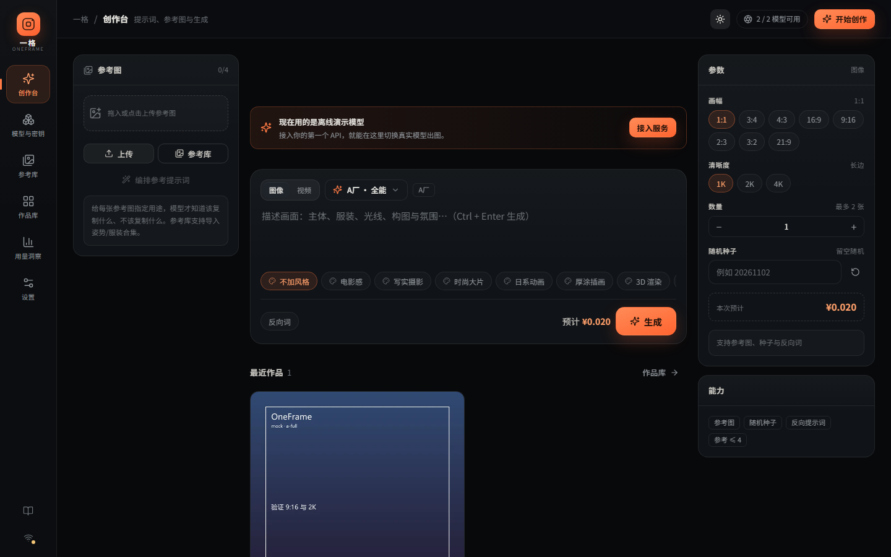
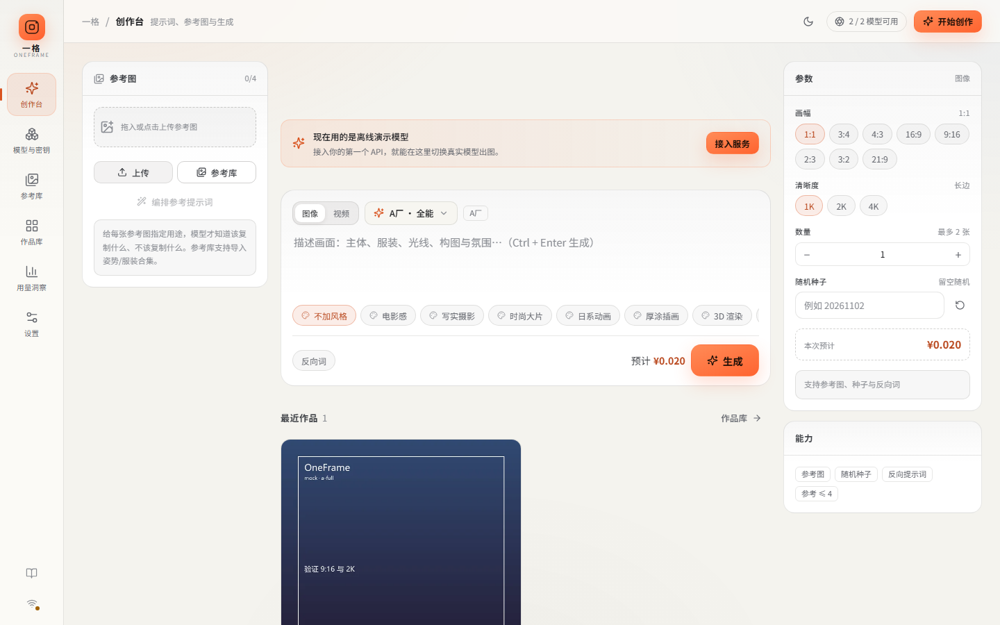
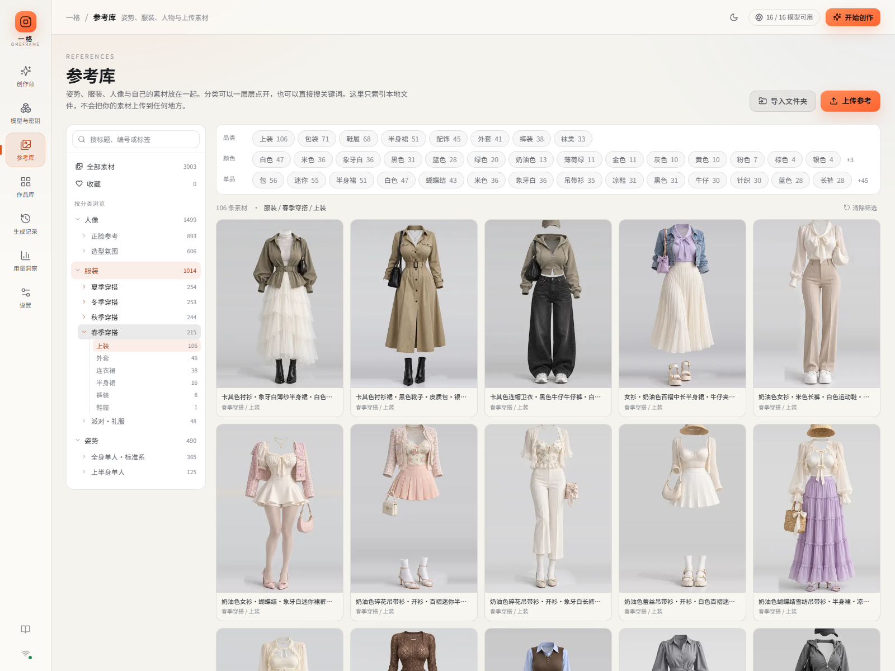

# OneFrame · 一格

**一个入口，接上你所有的图像与视频模型。**

把不同供应商的 API Key 收进本地，组合成自己的模型；在同一个工作台里写提示词、拼参考图、批量出图、生成视频，并管理所有作品。不用再来回切换网站、复制 Key、对比参数。

> 本地优先：单文件 SQLite + 本地媒体目录，密钥 Fernet 加密，默认只监听 `127.0.0.1`。没有账号、没有云端、没有遥测。



## 它解决什么

| 痛点 | OneFrame 的做法 |
| --- | --- |
| 十几个中转站/官方 Key 来回切 | 渠道 + 密钥池统一管理，每个「厂商 × 模型」都是独立入口 |
| 某个 Key 限流就卡住 | 401/429 的 Key 自动冷却，下一次任务换用同渠道其他 Key；当次不重试 |
| 每个站参数名都不一样 | 协议适配层（OpenAI Images/Videos、Gemini/Imagen/Veo、自定义 JSON） |
| 多图参考总是崩 | 参考图角色化（人物/服装/姿势/风格）+ 结构化提示词编排 |
| 出图散落各处 | 本地作品库、收藏、标签、复用参数、原图下载 |
| 不知道钱花在哪 | 每次任务的渠道、价格、耗时、成功率都有记录 |

## 功能

- **创作台**：图像 / 视频切换，模型下拉；图像按「画幅（含 4:3 / 9:16）+ 清晰度 1K/2K/4K」生成，视频按时长/分辨率；只显示当前模型真正支持的选项（参考图、种子、反向词、数量），参考图槽位与一键编排提示词，实时任务进度与结果网格。
- **模型与密钥**：接入渠道（一个地址 + 多个 Key）、测试连接、读取模型列表；每个「厂商 × 模型」独立建一条记录，配置能力与价格。同名模型在不同厂商下是不同选项。
- **参考库**：导入本地文件夹，或直接索引 `ai-pose-gallery-zh` 仓库；姿势 / 服装 / 人像三级分类树 + 角度、颜色、单品等维度筛选，空格分隔多关键词搜索，收藏与一键引用。NSFW 素材默认隐藏，可在「设置 → 内容与显示」开启。
- **作品库**：全部生成结果，图像/视频筛选、收藏、搜索、灯箱查看提示词与参数、复用、下载、删除；每张图可以一键存入参考库「我的作品」，下次直接当参考图用。
- **生成记录**：每次提交都有留档——模型、时间、耗时、费用、参数、失败原因与线路记录；失败、取消、待核对的记录也能查到或重试。
- **用量洞察**：作品数、成功率、花费、14 天趋势、渠道健康与常用模型。
- **深色 / 浅色主题**：可在「设置 → 外观」选深色、浅色或跟随系统，也可点右上角的太阳/月亮一键切换，偏好保存在本机。
- **离线演示**：没有 Key 也能完整体验流程（演示渠道使用占位图）。

### 创作工作流（A+B 新增）

- **参考库**：姿势支持白模 / 深度图切换与同组五视角；导入器支持 Shisei 中国历代服饰（本地 checkout 更新后可导入 227 个视角）；远程热链素材会明确报告并跳过。
- **创作台**：随机搭配（槽位可锁定）、换个姿势、从 URL / 剪贴板添加参考、三合一参考拼图、任务中心。
- **对比工作台**：结果 vs 参考（叠加滑杆、多参考切换、手动对齐）与作品 vs 作品（并排/叠加）。
- **后期**：局部重绘（OpenAI 兼容蒙版）、精修、本地 2x/4x 放大、宫格拆分。
- **一致性**：角色视角 / 表情 / 设定集工具；派生结果带版本血缘。
- **提示词**：提示词库、LLM 提示词改写（GLM 5.3 Flash，失败自动回退本地规则）、批量矩阵（同提示词多模型）。
- **参考归档**：作品参考图 ZIP 打包下载。

### 外观

深色是默认的创作环境；浅色适合白天或光线较强的房间。右上角太阳/月亮一键切换，选择会记住；「跟随系统」会随操作系统的深浅模式自动变化。



### 为什么没有「自动兜底」

一个模型只绑定一个厂商和一个上游模型名。**失败就是失败**：不会偷偷切到另一家厂商的同名模型，也不会为了成功而换模型重发。
401/403/429 只会让当前 Key 冷却，下一次任务换用同渠道的其他 Key；当次任务直接失败。5xx、超时、内容拒绝都不重试。

## 快速开始

要求：Windows / macOS / Linux，Python 3.11+，Node.js 20+。

```bash
# 1. 安装后端依赖
python -m venv .venv
.venv/Scripts/python -m pip install -r backend/requirements.txt   # Windows
# source .venv/bin/activate && pip install -r backend/requirements.txt  # macOS/Linux

# 2. 构建前端
cd frontend && npm install && npm run build && cd ..

# 3. 启动（自动打开浏览器）
.venv/Scripts/python backend/run.py
```

Windows 用户也可以直接双击 **`start.bat`**（首次会自动装依赖、构建前端）；双击 **`stop.bat`** 停止，或在启动窗口按 Ctrl+C。启动窗口需要保持打开，关掉窗口服务也会停。

如果双击没有反应：右键 `start.bat` →「打开方式」确认是 *Windows 命令处理程序*，或在 PowerShell 里执行 `cmd /c start.bat` 查看具体报错。

打开 `http://127.0.0.1:8787`。第一次进入会看到离线演示模型（右上角可切换浅色主题）；配置 Key 后即可使用内置的 Pollinations 模型，也可以到「模型与密钥 → 接入服务」添加其他 API。

### 姿势库怎么来

平台**不内置**第三方姿势/服装图片——两个参考图库的图片授权都禁止再分发，OneFrame 只做本地索引。

- **已经下载过** `ai-pose-gallery-zh`：在「设置 → 参考库目录」添加仓库根目录，再到「参考库 → 导入 → 姿势图库仓库」选择它即可。
- **还没下载**：在项目根目录运行

  ```powershell
  powershell -ExecutionPolicy Bypass -File tools\import-pose-gallery.ps1
  ```

  脚本会把仓库浅克隆到 `D:\0Z\ai-pose-gallery-zh`（约 1.1 GB，仅首次），自动加入参考库目录并导入 1439 组姿势 / 1407 套服装 / 1499 张人像。也可以自己 clone 后用界面导入。

### 参考库怎么分类

导入时会读出图库自带的层级，不再只压成一个大类：

| 类型 | 一级（左侧树） | 二级（左侧树） | 维度筛选（顶部） |
| --- | --- | --- | --- |
| 姿势 | 构图：上半身 / 全身标准 / 全身性感 / 双人缠绵 | 姿势分类：站姿、坐姿、趴卧、跪立…… | 角度：正面 / 侧面 / 斜侧 / 俯视 / 仰视 |
| 服装 | 风格：四季穿搭、内衣・睡衣、性感穿搭、泳装・度假、派对・礼服 | 主服装：连衣裙、半身裙、裤装、上装、外套…… | 品类、颜色、单品（蕾丝、蝴蝶结、长筒丝袜……） |
| 人像 | 分区：正脸参考 / 造型氛围 | 发长：短发 / 中发 / 中长发 / 长发 | 发型（51 种） |

- 左侧树每层都有折叠箭头：点分类名是筛选，点箭头只展开 / 收起，其他类型始终留在树里，不会整块消失。
- 顶部维度可多选，同一维度是「或」，不同维度之间是「且」。
- 搜索框按空格分词，全部命中才返回（例如 `黑色 连衣裙 荷叶边`），标题、编号、标签、品类和英文关键词都在索引里。
- 自己导入的普通文件夹按子目录归类：顶层目录是一级、末级目录是二级。
- 调整过分类规则或整理过原目录后，可运行 `.venv\Scripts\python.exe backend\reclassify.py` 重建；也可以在「导入文件夹」弹窗里点「重新整理分类」。重建只改索引，不动磁盘文件。



### 接入示例

- **OpenAI 兼容中转**：服务地址填 `https://你的中转站/v1`，Key 每行一个；该模型的上游模型名填该站文档里的名字。
- **Google Gemini**：地址 `https://generativelanguage.googleapis.com/v1beta`，上游模型 `gemini-2.5-flash-image`（图像）或 `veo-3.0-generate-001`（视频）。
- **自定义 JSON 接口**：选择「自定义 JSON 接口」，在模型的「自定义接口模板」里填写请求模板、响应字段与可选的轮询配置；详见 [接入指南](docs/03-接入指南.md)。

### 内置 Pollinations（默认图像模型）

首次启动会自动创建 `Pollinations` 渠道和三个模型：Flux Schnell（纯文生图）、Kontext（单参考图）、Flux.2 Klein（多参考图，默认）。Key 不写在代码里，二选一：

- **环境变量**：启动前设置 `POLLINATIONS_API_KEY=sk_...`。Windows PowerShell 当前窗口：`$env:POLLINATIONS_API_KEY="sk_..."`；持久化：`setx POLLINATIONS_API_KEY "sk_..."` 后重开终端。
- **界面**：「模型与密钥 → Pollinations → 密钥」。

环境变量只在启动时读取，写入本机加密密钥池后可以移除；没有 Key 时内置模型显示为不可用，不影响离线演示。Pollinations 模型会把提示词发送到 pollinations.ai，按 Pollen 计费。

> 密钥只在后端解密使用，接口从不回传明文；除可选的环境变量外不需要 `.env` 文件，其余配置都在界面里。

## 配置

| 环境变量 | 默认 | 说明 |
| --- | --- | --- |
| `ONEFRAME_DATA` | `./data` | 数据目录（数据库、媒体、密钥） |
| `ONEFRAME_HOST` / `ONEFRAME_PORT` | `127.0.0.1` / `8787` | 监听地址 |
| `ONEFRAME_IMAGE_WORKERS` / `ONEFRAME_VIDEO_WORKERS` | `3` / `2` | 并发 |
| `ONEFRAME_LIBRARY_ROOTS` | 空 | 参考库可读取的额外目录（`;` 分隔）；也可在设置页添加 |

## 目录

```
backend/app/
  providers/     协议适配器（openai_image、openai_video、gemini_*、generic、mock）
  core/router.py 能力校验、厂商/模型绑定、密钥池、价格估算
  core/worker.py 任务执行：提交 → 轮询 → 下载 → 缩略图 → 落库
  core/prompt.py 风格预设与参考图提示词编排
  core/library.py本地参考库索引、分面查询与重建
  core/taxonomy.py 参考库多级分类规则
frontend/src/    React 19 + Vite 工作台
docs/            分析与设计文档
data/            运行时数据（已 gitignore）
```

## 文档

- [三个项目的分析与整合方案](docs/01-三仓库分析与整合方案.md)
- [架构与数据模型](docs/02-架构与数据模型.md)
- [接入指南（含自定义接口模板）](docs/03-接入指南.md)

## 测试

```bash
cd backend
../.venv/Scripts/python -m pytest tests -q
```

## 关于参考素材的版权

`ai-pose-gallery-zh` 与 `open-pose-costume` 的**代码**开源，但**图片与数据不适用 MIT**，原作者禁止再分发。OneFrame 不打包、不托管这些图片：参考库只索引你本机已有的副本。请自行确认素材授权，商用前尤其注意。

## License

MIT（仅本项目代码）。
